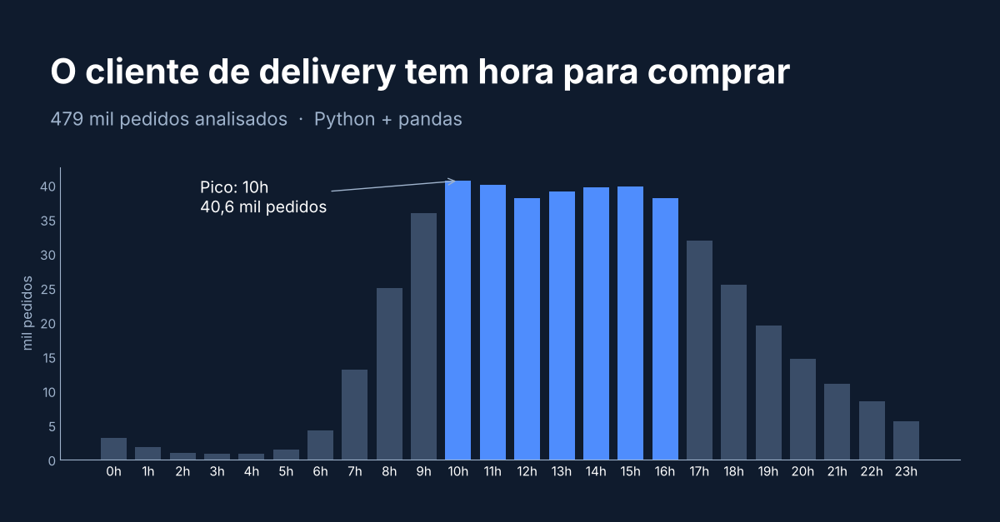

# Vamos encher o carrinho: o que os pedidos de um app de mercado revelam sobre hábito de compra

Análise de cerca de **479 mil pedidos** e **4,5 milhões de itens** da Instacart, um app de entrega de supermercado parecido com o iFood Mercado.

As perguntas são de negócio: **quando** o cliente compra, **de quanto em quanto tempo** ele volta e **o que** ele compra, recompra e coloca primeiro no carrinho.



## Resultado em 30 segundos

- **Horário:** das 10h às 16h, mais de 38 mil pedidos por hora. O pico é às 10h. De madrugada, quase nada.
- **Dia:** domingo e segunda são os dias mais fortes.
- **Recorrência:** o ciclo de compra é semanal, com pico em 7 dias. Um grupo grande demora 30 dias ou mais: clientes que esfriaram.
- **Retenção:** 35% dos clientes fizeram só 1 pedido. O maior gargalo é a segunda compra.
- **Produtos:** hortifrúti domina vendas e recompra (banana em 1º). Bebidas e leite aparecem como os itens que abrem o carrinho.

## Como eu usaria isso num negócio

- Concentrar campanha e push entre 9h e 16h, com reforço no domingo e na segunda.
- Montar régua de reativação perto do 7º dia e uma ação específica para quem passou de 30 dias.
- Investir em incentivo de segunda compra.
- Usar hortifrúti como produto-isca e os itens de primeiro carrinho como vitrine de entrada no app.

## Limpeza dos dados

Antes de analisar, investiguei a causa de cada problema. É isso que define se o certo é remover, preencher ou manter.

| Problema | O que encontrei | Decisão |
|---|---|---|
| Pedidos duplicados | 15, todos na quarta às 2h | Removidos (falha de sistema) |
| Nomes de produto repetidos | 104 | Mantidos (IDs diferentes) |
| Nome de produto ausente | 1.258, todos na categoria "missing" | Preenchidos com "Unknown" |
| Dias desde o pedido anterior ausente | 28.819, todos de primeiro pedido | Mantidos (ausência esperada) |
| Posição no carrinho ausente | 836, em 70 pedidos com mais de 64 itens | Preenchidos com 999 |

## Limitações

- A base é uma amostra reduzida da original. As contagens por cliente valem para os pedidos dessa amostra.
- As conclusões são descritivas. Para afirmar diferenças com segurança, o próximo passo seria um teste estatístico.

## Ferramentas

Python · pandas · matplotlib · Jupyter Notebook

## Arquivos

- `vamos-encher-o-carrinho.ipynb`: análise completa, com código e explicações
- `images/`: gráfico usado neste README

## Como rodar

```bash
pip install pandas matplotlib jupyter
jupyter notebook vamos-encher-o-carrinho.ipynb
```

O notebook lê os 5 arquivos CSV (`instacart_orders`, `products`, `aisles`, `departments` e `order_products`) da mesma pasta.

---

**Deivison**: gestor de tráfego e especialista em marketing digital. Uso dados para decidir onde investir e onde cortar.
Vamos conversar no [LinkedIn](https://www.linkedin.com/in/SEU-PERFIL).
